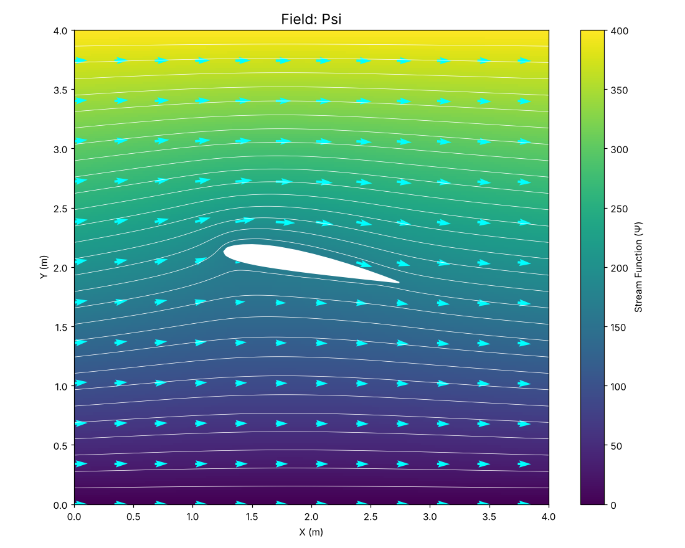
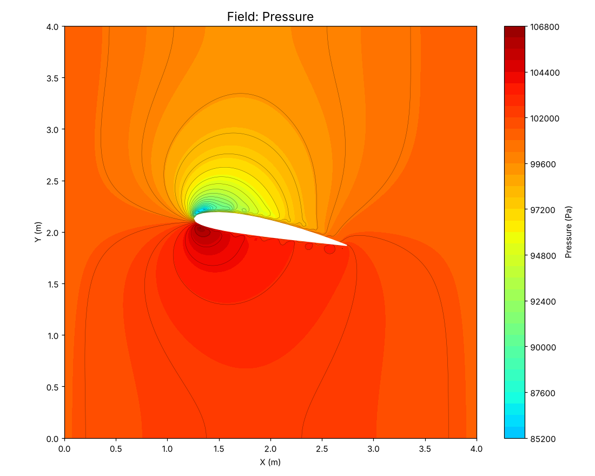
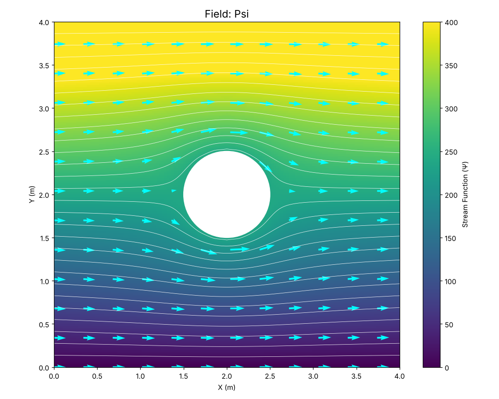
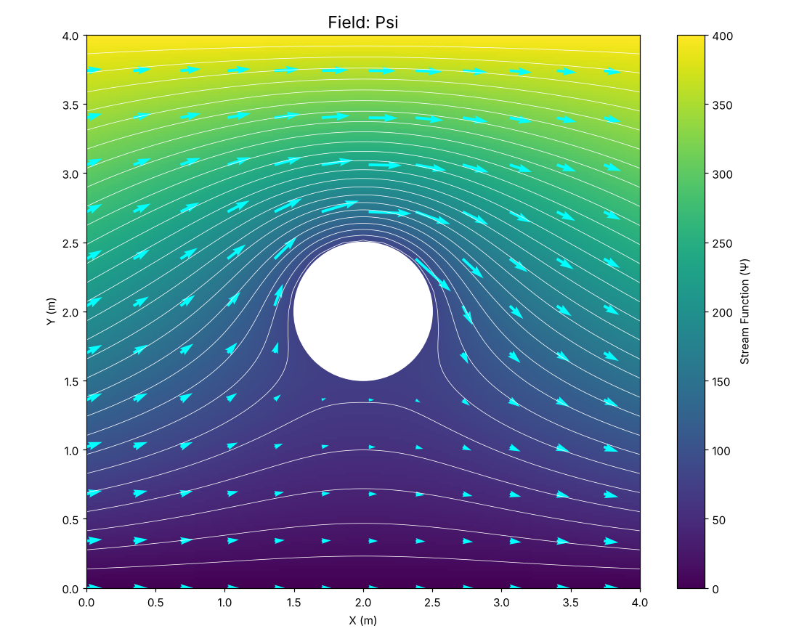
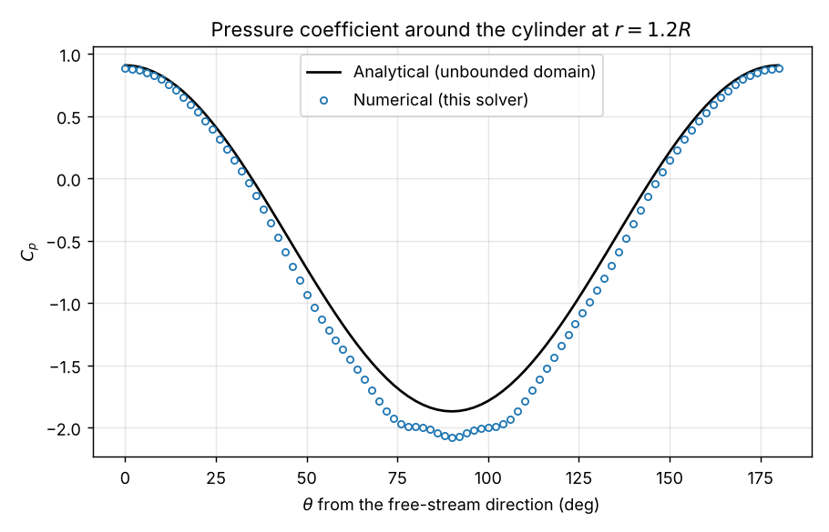
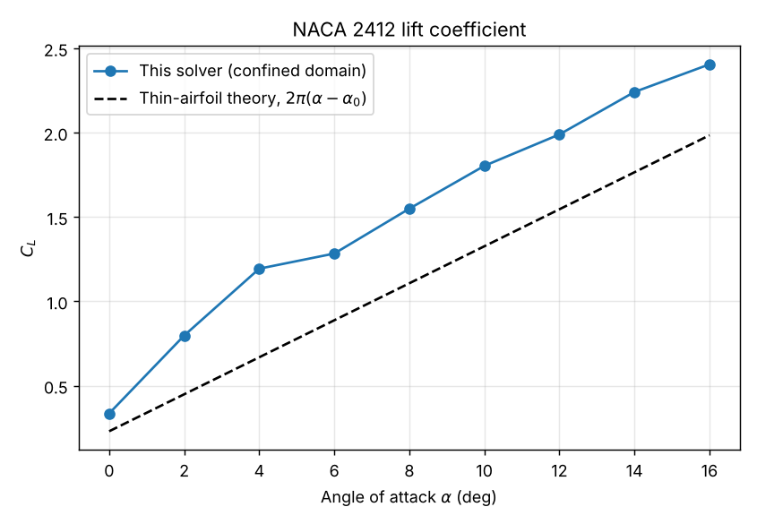
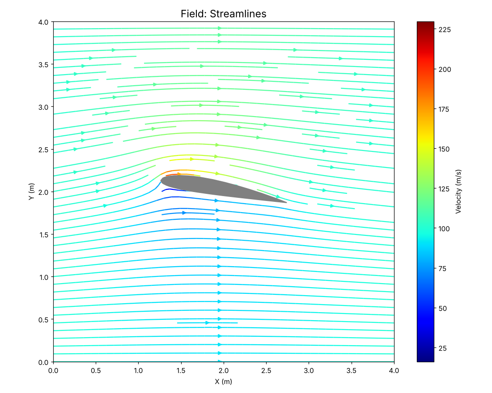

# Potential-Flow Solver: Cylinder and NACA 2412 Airfoil

A finite-difference solver for 2D incompressible, inviscid and steady flow, written in Python from scratch. It solves the Laplace equation for the stream function with the Gauss–Seidel method with Successive Over-Relaxation (SOR), computes the velocity and pressure fields, and integrates the surface pressure to get the lift. It handles a **cylinder** (fixed or rotating, Magnus effect) and an **airfoil** loaded from its coordinates (NACA 2412), with the Kutta condition at the trailing edge.

<p align="center">
  
  
</p>
<p align="center"><em>NACA 2412 at 10° angle of attack: stream function with velocity vectors (left) and pressure field (right).</em></p>

## Method

- **Governing equation:** ∇²ψ = 0 on a uniform Cartesian grid (4 m × 4 m, Δx = Δy = 0.02 m), discretised with second-order central differences.
- **Solver:** Gauss–Seidel iteration with Successive Over-Relaxation (SOR, ω = 1.8): each node is updated in place with the newest values of its neighbours, and the update is over-relaxed to converge faster. It iterates until the maximum change is below 10⁻⁶.
- **Boundary conditions:** uniform flow (ψ = V∞·y) on the domain boundary and a constant ψ on the body. For the rotating cylinder the value of ψ on the surface depends on the rotation speed, which adds circulation. For the airfoil the body value of ψ is set from the trailing-edge position, a simplified way of imposing the Kutta condition (the flow leaves the trailing edge smoothly). It can be switched off to compare.
- **Geometry:** the airfoil coordinates are scaled to the chord, rotated to the angle of attack and placed in the domain. Grid nodes inside the body are found with a point-in-polygon test.
- **Post-processing:** u and v from finite differences of ψ, pressure from Bernoulli's equation with ISA conditions at the chosen altitude, and lift from the pressure integrated over the surface nodes with their normals.

## Results

**Cylinder.** Fixed and rotating cylinders. With rotation, the circulation moves the stagnation points and creates lift (Magnus effect).

<p align="center">
  
  
</p>

**Validation against the analytical solution.** For the fixed cylinder, the pressure coefficient on a circle of radius 1.2 R follows the analytical potential-flow distribution. The suction peak is about 11 % deeper (Cp = −2.08 vs −1.87), because the analytical solution is for an infinite domain while here the cylinder blocks 25 % of the domain width, so the flow accelerates more around it. The stair-step body on the Cartesian grid adds some error too.

<p align="center"></p>

**Airfoil lift.** The lift coefficient of the NACA 2412 grows linearly with the angle of attack, with a slope of 7.0 per radian against 2π (6.28) from thin-airfoil theory. The values are higher than the theory mainly because of the confined domain: the chord is 1.5 m in a 4 m domain. Being inviscid, the model does not predict stall.

<p align="center"></p>

<p align="center"></p>

## How to run

```bash
pip install -r requirements.txt
python -m Main_Project_Simulations.Airfoil    # NACA 2412
python -m Main_Project_Simulations.Cylinder   # fixed and rotating cylinder
```

Each script has two modes: `main(execute=0)` runs the full simulation (a few minutes, plain Python loops), and `main(execute=1)` loads a saved result from `results/Numpy/` and plots it. Angle of attack, chord, altitude, grid and Kutta condition are set at the top of `Airfoil.py`. Any airfoil from the Airfoil Tools database can be used by adding its coordinates to `results/Airfoil_txt/`.

The scripts in `examples/` render the README figures, the Cp validation and the lift curve.

## Structure

```
CLibrary/
  DataModels.py     grid, atmosphere (ISA), cylinder and airfoil geometry
  Solver.py         boundary conditions, SOR solver, velocity, pressure, normals and lift
  Render.py         plots: stream function, pressure, velocity, streamlines
  StreamReader.py / StreamWriter.py   save and load results (.npz / .txt)
Main_Project_Simulations/   airfoil and cylinder cases
results/            airfoil coordinates and some saved results
examples/           figures, validation and lift curve
```

## Known limitations

- The body is represented by the grid nodes inside it (stair-step boundary), not by a body-fitted mesh.
- The domain is small compared with the body, which overestimates the velocities and the lift.
- The circulation (rotation, Kutta condition) is imposed through the value of ψ on the body, which is an approximation.
- The Gauss–Seidel/SOR loops are written in plain Python and are not vectorised.

## Context

Developed for the Fluid Mechanics course project at EETAC–UPC (spring 2025), as a team of three: Joel Valiente, Gerard Artó and Andreu Bueno.

## Author

Andreu Bueno Álvarez — Aerospace Systems Engineering, EETAC–UPC.
